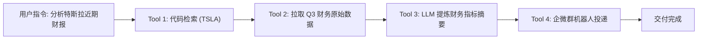
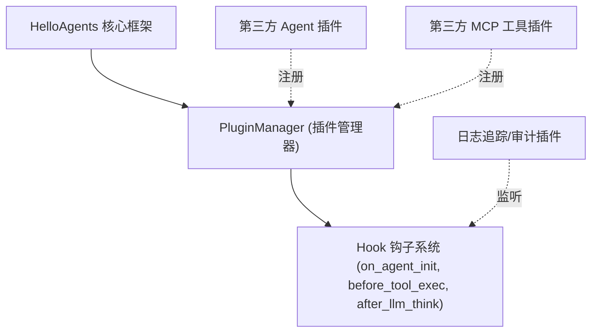

# Task02: 第七章 构建你的 Agent 框架 - 习题解答

---

### 第 1 题：自建 Agent 框架理念与架构设计分析

#### 1.1 主流框架的四大局限性及对开发效率的影响
结合工业界与开源框架（如 LangChain）的使用经验，四大痛点对研发效率的负面影响具体表现为：
1. **过度抽象与深层调用栈**：为了支持极端通用场景，引入了繁杂的链式封装（Chains、Runnables、Callbacks），出现报错时堆栈动辄几十层，极难使用常规断点定位到根因，排查耗时远超手写核心逻辑；
2. **接口破坏性变更频繁**：框架在快速迭代中经常重构核心类与导入路径（如 `langchain` 拆分为 `langchain-core`、`langchain-community`），版本升级往往伴随大面积代码重构，产生高昂的技术债务；
3. **黑盒化掩盖关键 Prompt**：底层将 System Prompt 和重试逻辑严密封装，开发者难以精准把控究竟向大模型发送了什么 Token，严重阻碍针对业务边界的细粒度 Prompt 调优；
4. **依赖树臃肿冲突**：全家桶式框架引入了大量非必要的重型第三方包，在微服务容器化打包或与现有企业库协同部署时，极易诱发严重的依赖版本冲突。

#### 1.2 “万物皆为工具”理念的优势与局限性
- **核心优势**：
  - **概念模型极简**：抹平了记忆系统、外部搜索引擎、RAG 向量检索乃至代码解释器的概念壁垒，统一为“输入参数 ➔ 返回观察”，大幅降低新手的学习认知曲线；
  - **调度机制统一**：Agent 内部只需要维护一套 `ToolRegistry` 与工具派发逻辑，代码极为内聚，不易出现因各模块异构导致的接口胶水代码膨胀。
- **潜在局限性（举例说明）**：
  - **弱化了特定子系统的底层治理能力**：例如将长短期记忆（Memory）简单视为一个返回字符串的 Tool，可能导致 Agent 遗漏复杂的记忆遗忘曲线（Decay）、动态权重衰减或重要度反思排序机制；
  - **时序与感知被动化**：常规工具是被动调用的，而复杂的上下文工程往往需要在模型思考**之前**静默完成上下文组装注入（Pre-injection），若完全拘泥于“Tool Call”触发，会徒增一轮额外的模型推理往返（Round-trip）。

#### 1.3 从零脚本到框架化的演进改进与核心设计原则
- **具体改进**：从第四章各模块“硬编码、零散组织、逻辑高度绑定”演化为“面向对象分层、依赖注入、接口统一、全局配置单例化”。
- **自研框架优先考虑的原则**：
  1. **极简主义与零多余依赖**（KISS 原则）：仅依赖核心 SDK，保持底层代码 100% 透明可断点调试；
  2. **开闭原则（OCP）**：核心决策流对修改关闭，工具、记忆和模型提供商对扩展开放；
  3. **可观测性优先**：原生支持全链路步骤流转、Token 消耗统计与执行耗时埋点。

---

### 第 2 题：HelloAgentsLLM 扩展与模型推理引擎对比

#### 2.1 为 HelloAgentsLLM 继承扩展新提供商（以 Kimi/Moonshot 为例）
通过继承并在初始化方法中拦截 `provider="moonshot"` 即可实现：

```python
import os
from typing import Optional
from openai import OpenAI
from hello_agents import HelloAgentsLLM

class MyExtendedLLM(HelloAgentsLLM):
    def __init__(
        self,
        model: Optional[str] = None,
        api_key: Optional[str] = None,
        base_url: Optional[str] = None,
        provider: Optional[str] = "auto",
        **kwargs
    ):
        # 自动探测或显式指定
        if provider == "moonshot" or (provider == "auto" and os.getenv("MOONSHOT_API_KEY")):
            self.provider = "moonshot"
            self.api_key = api_key or os.getenv("MOONSHOT_API_KEY")
            self.base_url = base_url or "https://api.moonshot.cn/v1"
            self.model = model or os.getenv("LLM_MODEL_ID") or "moonshot-v1-8k"
            self.timeout = kwargs.get('timeout', 60)
            self._client = OpenAI(api_key=self.api_key, base_url=self.base_url, timeout=self.timeout)
        else:
            super().__init__(model=model, api_key=api_key, base_url=base_url, provider=provider, **kwargs)
```

#### 2.2 自动检测机制的优先级冲突分析
- **冲突场景**：当同时存在 `OPENAI_API_KEY`（云端商业密钥）与 `LLM_BASE_URL="http://localhost:11434/v1"`（本地 Ollama 端口）。
- **框架最终选择**：若按常规顺序先探测 `OPENAI_API_KEY`，框架会误判为官方 OpenAI 服务，导致请求打向公网云端；
- **合理性评价与优化建议**：该设计不够严谨。**Base URL 的显式覆盖优先级应当高于通用 API Key 探测**。在实际工程中，若检测到用户显式指定了自定义或本地私网的 `BASE_URL`，系统应强制以该端点所属的协议族（如 Ollama/Local）优先路由，避免无意识地将本地私有数据泄露至公网。

#### 2.3 本地推理引擎对比：VLLM vs SGLang vs Ollama
| 评估维度 | VLLM | SGLang | Ollama |
| :--- | :--- | :--- | :--- |
| **定位与易用性** | 工业级高吞吐推理服务端，配置需对齐 CUDA/算力卡 | 针对复杂 Prompt 与结构化解码的高阶服务端 | 桌面级开箱即用，类 Docker 命令一键拉起模型 |
| **核心技术优势** | PagedAttention 显存优化，高并发 Continuous Batching | RadixAttention 缓存复用，结构化输出/分支速度领先 | 极轻量，底层依托 llama.cpp，支持 CPU/GPU 混合离屏 |
| **资源占用** | 显存吃满（默认预分配 90% 显存供 KV Cache） | 显存利用精细，多轮交互/树状搜索场景显存复用高 | 内存占用低，支持 GGUF 多级量化（4-bit/8-bit） |
| **推理速度与精度** | 高并发吞吐量极佳，半精度无损输出 | 复杂链式/结构化解码吞吐超越 VLLM，精度无损 | 单请求延迟尚可，高并发吞吐较低，量化有微小精度损耗 |

---

### 第 3 题：核心基础接口与设计模式分析

#### 3.1 `Message` 类采用 Pydantic BaseModel 的优势
1. **严格的强类型校验**：在数据进入智能体前拦截非法角色（Role）或无效字段，防止因隐蔽拼写错误导致运行时静默失效；
2. **原生开箱即用的序列化**：提供简洁的 `.model_dump()` 与 `.model_dump_json()`，极大简化持久化存储与网络传输；
3. **不可变性与文档自解释**：定义即契约，使大型协同项目中的团队成员清晰感知消息对象的数据边界。

#### 3.2 `Agent` 基类的 `run` 与 `_execute` 设计模式
- **设计模式名称**：**模板方法模式（Template Method Pattern）**。
- **核心好处**：
  - **核心骨架复用**：`run()` 统管通用前置校验、日志记录、异常捕获和对话历史维护，所有智能体天然具备统一行为；
  - **职责清晰隔离**：派生类开发者只需专注于实现 `_execute()` 内部特定的决策循环，无需反复重复书写样板代码。

#### 3.3 `Config` 类的单例模式（Singleton）剖析
- **概念说明**：确保整个运行期系统中有且仅有一个 `Config` 实例，提供全局统一的访问点。
- **必要性**：避免频繁从磁盘解析 `.env` 产生 I/O 开销，保证各个模块访问到的配置始终保持状态一致；
- **非单例的危害**：若多处分散实例化配置对象，运行时动态修改某项配置（如切换模型温控 `temperature`）将无法全局生效，出现不同组件各执一词的“配置分裂”现象。

---

### 第 4 题：四种 Agent 范式框架化实现剖析

#### 4.1 ReActAgent 框架化相比第四章独立脚本的 3 个具体改进
1. **解耦工具执行内核**：由零散字典调用演变为接入标准化 `ToolRegistry`，支持运行时动态增删工具；
2. **统一状态机生命周期**：继承自基类，生命周期与对话上下文由框架统一托管，杜绝全局变量污染；
3. **增强型容错与退出机制**：将异常捕获提升至框架规范，支持在最大步数超限时优雅降级并输出友好的未完成提示。

#### 4.2 ReflectionAgent 增加“质量评分（Scoring）”机制设计
在反思评委的 Prompt 中增加结构化 JSON 输出要求（包含 `score: int` 与 `critique: str`）：
- 评委模型每次反思输出 0~100 的综合分；
- 设定阈值（例如 `threshold = 85`）；
- 若 `score >= threshold`，触发提前终止并交付当前版本，有效兼顾输出质量并节约多轮无意义的 Token 开销。

#### 4.3 新范式设计：Tree-of-Thought (ToT) Agent 架构
```python
from hello_agents import Agent

class TreeOfThoughtAgent(Agent):
    """
    思维树 (ToT) 智能体：每一步生成分支，评估打分后回溯或推进最优路径
    """
    def __init__(self, name: str, llm, branches: int = 3, max_depth: int = 3):
        super().__init__(name=name, llm=llm)
        self.branches = branches
        self.max_depth = max_depth

    def _execute(self, task: str) -> str:
        current_paths = [f"初始任务: {task}"]
        for depth in range(self.max_depth):
            candidates = []
            # 1. 广度展开：针对每个路径生成 k 个可行方案
            for path in current_paths:
                candidates.extend(self._generate_thoughts(path, self.branches))
            # 2. 启发式剪枝评估：让 LLM 给各候选思考打分
            ranked_candidates = self._evaluate_and_rank(candidates)
            # 3. 选取 Top-N 最优路径进入下一轮深入
            current_paths = ranked_candidates[:self.branches]
            if self._is_solved(current_paths[0]):
                break
        return self._summarize_best_path(current_paths[0])
```

---

### 第 5 题：工具系统与执行机制

#### 5.1 `BaseTool` 强制统一接口的理由与多返回值设计
- **强制统一理由**：面向接口编程。`Agent` 调度工具时无需关心具体是计算器还是浏览器，只需统一调用 `tool.execute()`，达成无缝多态；
- **多返回值设计方案**：强制返回标准结构化对象（如 Pydantic 定义的 `ToolResult(data=..., metadata=...)` 或结构化 `Dict`），在转为 Prompt 文本时由系统自动序列化，既满足下游代码解析，又便于大模型提取关键字段。

#### 5.2 工具链（`ToolChain`）实战设计：智能财经研报速递
- **业务流程**：
  $$\text{股票代码检索工具} \xrightarrow{\text{code}} \text{财务财报拉取工具} \xrightarrow{\text{data}} \text{财经大模型深度摘要工具} \xrightarrow{\text{report}} \text{企业微信机器人推送工具}$$
- **流程图**：


#### 5.3 异步工具执行器（`AsyncToolExecutor`）性能提升的边界
- **显著提升场景**：**I/O 密集型操作**（如并发请求 5 个不同的外部搜索 API、同时读写多个远程数据库、批量下载网页内容），利用线程池可将总耗时从串行累加缩短至最长单次耗时；
- **无明显增益场景**：**CPU 密集型运算**（如复杂本地密码破解、密集矩阵乘法，受制于 Python GIL）或**强时序依赖操作**（后一工具入参严格依赖前一工具返回）。

---

### 第 6 题：高级特性扩展设计

#### 6.1 流式输出（Streaming）改造方案
1. **底层 `HelloAgentsLLM` 改造**：在 `think()` 方法中暴露 `stream: bool = False` 参数，当开启时返回 `Generator[str, None, None]`；
2. **基类 `Agent` 扩展**：增加 `run_stream()` 抽象方法，返回迭代生成器，边接收 Token 边通过回调推送给前端 UI；
3. **上层兼顾**：对于非流式应用继续保留原 `run()` 方法，保证向后兼容性。

#### 6.2 多轮对话管理与分支回溯系统设计
- **新增核心类**：`ConversationNode`（包含节点 ID、父节点引用、消息体、子节点列表）与 `ConversationTree`（会话树）；
- **集成与回溯机制**：不再将历史维护为平铺一维列表，而是树状拓扑图。当用户要求“换个思路回答上一问题”时，系统创建新子分支，激活指针移动到新叶子节点，天然支持分支漫游与时空穿越。

#### 6.3 框架插件系统（Plugin System）架构设计
- **关键设计架构**：

- **核心接口定义**：定义 `BasePlugin` 基类，第三方通过继承并实现 `register(registry)` 与生命周期钩子方法，放置于 `plugins/` 目录或通过标准 Python EntryPoints 机制实现即插即用发现。
