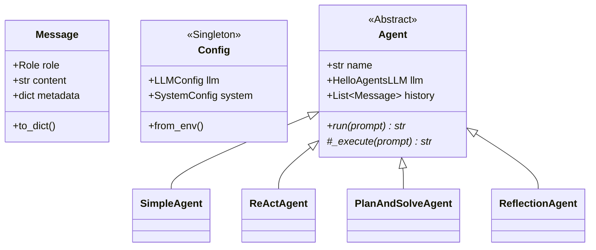

# 第七章 构建你的 Agent 框架 - 学习笔记

---

## 零、背景：为何需要从零自建 Agent 框架？

在 LangChain、LlamaIndex 等商业化开源框架林立的今天，自建框架并不是“重复造轮子”，而是从“使用者”向“架构设计者”跨越的必经之路：
1. **摆脱黑盒化与过度抽象**：主流框架为了追求极致通用性，引入了层层封装的 Chain、AgentExecutor、Callback 等复杂概念，学习曲线陡峭且内部执行逻辑高度黑盒；
2. **亲历亲为，透视底层机理**：通过亲手编写从 Prompt 拼装、输出解析、状态机循环到工具执行的每一行代码，才能深刻理解各组件之间的耦合关系与设计权衡；
3. **为深度定制打下底层掌控力**：在金融、医疗等垂直领域，企业对低延迟、高并发、安全审计与私有化部署有严苛要求，通用框架往往过于臃肿，自建或自研轻量框架能带来 100% 的代码掌控权。

---

## 一、HelloAgents 框架的核心设计哲学

1. **轻量与教学友好**：极简依赖（仅依赖 OpenAI SDK 及基础库），代码清晰透明，易于断点调试；
2. **基于工业界标准 API**：全面遵循 OpenAI 兼容接口，降低迁移成本；
3. **核心设计亮点——“万物皆为工具”**：
   - 框架摒弃了为 Memory、RAG、MCP 分别构建庞大独立抽象的做法；
   - **将记忆提取、知识检索、协议通信全部收束抽象为一种标准的“Tool”**，极大降低了开发者的心智负担，使系统保持纯粹的“智能体 ➔ 调用工具”闭环。

> **Quick Start（快速上手）**：
> ```bash
> pip install "hello-agents==0.1.1"
> ```
> 配合 `.env` 中的模型凭证，三行代码即可拉起一个支持工具调用的标准 Agent。

---

## 二、HelloAgentsLLM 扩展体系

大模型是智能体的“大脑”，`HelloAgentsLLM` 充当统一的模型调用中枢：

### 1. 多模型提供商支持（继承与重写）
- 不修改第三方库源码，通过面向对象的**继承机制**派生 `MyLLM(HelloAgentsLLM)`；
- 在 `__init__` 中拦截自定义 `provider`（如 `provider="modelscope"`），处理专属环境变量与默认 Base URL，其余情况调用 `super().__init__()` 优雅回退。

### 2. 本地推理引擎集成
- **生产级高并发**：支持接入 **VLLM**（PagedAttention 机制，高吞吐并行推理）；
- **轻量极速体验**：支持接入 **Ollama**（一键拉起本地量化模型，默认监听 `http://localhost:11434/v1`）；
- 本次实训直接通过环境变量无缝接入 **ModelScope (阿里魔搭社区)** 提供的免费在线推理 API，兼具稳定与低延迟。

### 3. 智能自动检测机制（Auto-Detection）
框架内部通过两大约束实现“开箱即用”：
- `_auto_detect_provider()`：按预设优先级探测当前环境中已配置的 API Key；
- `_resolve_credentials()`：自动解析对应的 Base URL 与推荐模型 ID。
- **架构哲学**：*“简单开始，逐步完善”*——先让最基础的调用以最低成本跑通，再按需扩展高阶配置。

---

## 三、框架核心基础接口与设计模式

为了让代码具备工程级扩展性，框架在 `core/` 下抽象了三大核心组件：



1. **`Message` 类（对话历史契约）**：
   - 基于 `Pydantic` 的 `BaseModel` 实现；
   - 强制约束 `role`（system/user/assistant/tool）与 `content` 结构，自动完成类型校验与序列化，杜绝了散装字典传参造成的隐蔽类型 Bug。
2. **`Config` 类（全局配置单例）**：
   - 采用**单例模式（Singleton Pattern）**，避免配置在系统多处重复实例化与读取开销；
   - 集中管理硬编码配置与缺省值，核心静态方法 **`from_env()`** 支持环境变量优先覆盖默认值。
3. **`Agent` 抽象基类（模板方法模式）**：
   - 利用 Python `abc` 模块（`ABCMeta` / `@abstractmethod`）强制子类契约；
   - **设计模式亮点——模板方法模式（Template Method）**：
     - 公开方法 `run()` 负责通用流程（消息包装、前置日志、历史存盘、后置清理）；
     - 保护方法 `_execute()` 留给各派生类实现具体的范式决策逻辑。

---

## 四、经典范式的框架化实现（面向对象重构）

在第四章零散脚本的基础上，本章将其重构为继承自 `BaseAgent` 的标准体系：

| Agent 类名 | 核心定位 | 框架内协同方式 |
| :--- | :--- | :--- |
| **`SimpleAgent`** | 轻量基准智能体 | 纯 Prompt 对话，支持即插即用挂载工具，用于轻量应答 |
| **`ReActAgent`** | 动态推理行动 | 规范化 `Thought -> Action -> Observation` 循环，对接 `ToolRegistry` |
| **`PlanAndSolveAgent`** | 规划求解分离 | 内部实例化 `Planner` 与 `Executor`，长链任务逐层推进 |
| **`ReflectionAgent`** | 自省迭代提升 | 维护内部 `Memory` 轨迹，调度执行者与反思评委轮转纠错 |

---

## 五、工具系统设计与高阶特性

1. **`BaseTool` 抽象基类**：强制统一 `name`、`description` 与 `execute()` 签名，支持自省输出工具定义；
2. **`ToolRegistry`（工具注册表）**：提供类似字典的注册、查询与格式化注入接口；
3. **`ToolChain`（工具链模式）**：支持将多个原子工具首尾相连，上一工具的输出自动注入为下一工具的输入；
4. **`AsyncToolExecutor`（异步执行器）**：利用 `concurrent.futures.ThreadPoolExecutor` 并行发起外部工具调用，显著降低 I/O 密集型操作的等待时延。

---

## 六、思考与互动：框架中哪一部分最适合扩展？

> **思考结论**：**工具系统（`tools/` 及其 `ToolRegistry`）是全框架中最适合、也最具业务扩展价值的部分。**

**核心理由**：
1. **契合“万事万物皆为工具”的顶层哲学**：未来的知识检索（RAG）、记忆读写（Memory）以及外部设备交互（MCP），在架构底层都能无缝作为 `BaseTool` 接入；
2. **坚守“开闭原则（OCP）”**：业务扩展（如新增查股票、发邮件、绘图工具）完全**无需修改**任何 Agent 基类代码，仅需派生 `BaseTool` 并向 `ToolRegistry` 注册即可全局生效；
3. **易于横向叠加企业级治理能力**：工具层是做安全沙箱隔离、参数类型白名单校验、权限审计与异步并发加速的最佳切入点。
